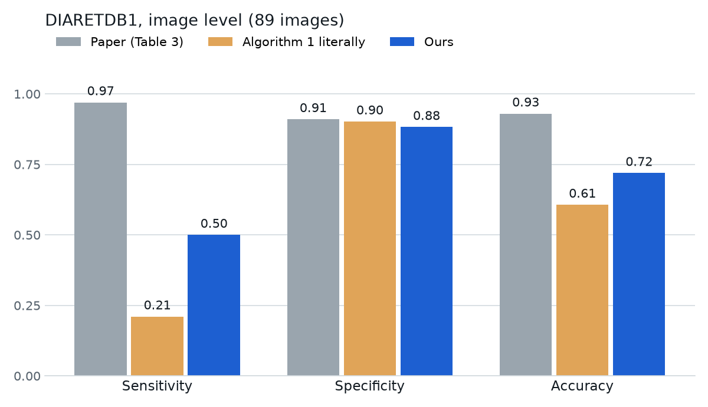
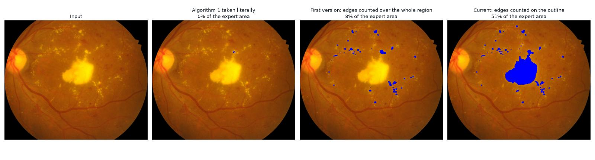
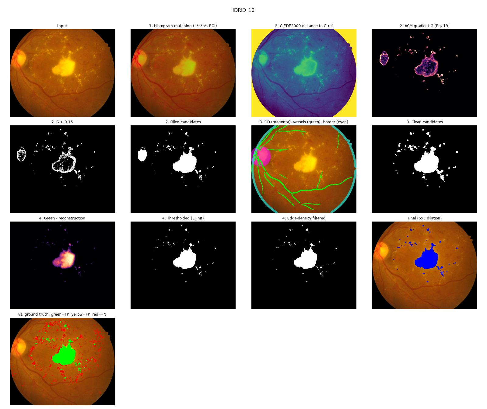

# Exudate Detection in Color Fundus Images by Adaptive Color Morphology

Python implementation of the exudate-detection part (Section III-A, Algorithm 1) of:

> M. Rostamian, M. Shekari, *Designing an Adaptive Color Morphology Operator for
> Exudates and Microaneurysms Detection in Color Fundus Images*, IEEE Access,
> vol. 14, pp. 54937–54953, 2026. doi:10.1109/ACCESS.2026.3680927

Team: Borda Darius, Jecan Alexandru, Ana Mustatia.

## Setup

```bash
python -m venv .venv
.venv\Scripts\activate          # Windows  (Linux/macOS: source .venv/bin/activate)
pip install -r requirements.txt
```

## Datasets

| Dataset | Used for | Where |
|---|---|---|
| **DIARETDB1** (89 images, expert exudate maps) | the paper's own benchmark (image-level, Table 3) and the histogram-matching reference image `image006.png` | official zip `diaretdb1_v_1_1.zip` (LUT University; the original site is offline, an archived copy is on the Internet Archive) → extract to `data/DIARETDB1/` |
| **IDRiD** segmentation set (81 images, pixel-level hard-exudate and optic-disc masks, CC-BY 4.0) | pixel-level evaluation; choosing the values the paper does not give (training images only) | `A. Segmentation.zip` from <https://zenodo.org/records/17219542> → extract to `data/IDRiD/` |

The reference color statistics (`exudates/reference_stats.json`) are already
included, so the detector works on any image without the datasets. To regenerate them from DIARETDB1:

```bash
python make_reference.py        # writes exudates/reference_stats.json
```

## Exora: the web app (easiest)

**Exora** is the web interface for the detector. The name comes from *exudate* +
*ora serrata*, the edge of the retina.

Double-click **`start.bat`** (Windows; the first run creates `.venv` and installs
everything), or run:

```bash
python app.py                   # opens http://127.0.0.1:7860
```

Drop a fundus photo on the page or pick a sample. Exora shows:

- the verdict for the whole photo and the marked area,
- a before/after slider with the detected exudates in blue, and a download of the result,
- every stage of Algorithm 1, with a short explanation of each,
- for DIARETDB1 and IDRiD photos with expert annotations in `data/`, a comparison with the experts.

The detection settings (τ_ACM, image rule) can be changed on the page; *Use the paper's τ = 20*
switches to the paper's value. The interface only displays results: all analysis is done by
`exudates/detection.py`, the same code the evaluation scripts use.

| File | What it is |
|---|---|
| [app.py](app.py) | small web server (FastAPI) that runs the detector on an uploaded photo |
| [web/](web/) | the page: `index.html`, `style.css`, `app.js` |
| [examples/](examples/) | sample photos from IDRiD (P. Porwal et al., IEEE Dataport 2018, doi:10.21227/H25W98, CC BY 4.0) |

## Command line

```bash
# one image or a folder (--steps saves a figure with every stage of Algorithm 1)
python detect.py "data/DIARETDB1/diaretdb1_v_1_1/resources/images/ddb1_fundusimages/image015.png" --steps

python evaluate_ddb1.py            # image-level SE / SP / accuracy on DIARETDB1 (as in the paper)
python evaluate.py --split test    # pixel-level on the IDRiD test set
python evaluate_od.py              # optic disc localization vs. IDRiD OD masks
python tune.py                     # re-select the unspecified values (IDRiD training set)
python tune_tau.py                 # tau_ACM and the image-level rule (IDRiD training set)
python tune_edge.py                # edge-filter settings (IDRiD training set)
python make_figures.py             # figures for the report -> docs/figures/

# detect.py, evaluate.py and evaluate_ddb1.py also accept:
python evaluate_ddb1.py --paper-values     # the paper's tau_ACM = 20, everything else as ours
python evaluate_ddb1.py --strict-paper     # Algorithm 1 taken literally (see below)
```

## Tests

```bash
pip install -r requirements-dev.txt
python -m pytest
```

| Test file | What it checks |
|---|---|
| [test_ciede2000.py](tests/test_ciede2000.py) | CIEDE2000 against all 34 published test pairs of Sharma et al. (2005) |
| [test_color_morphology.py](tests/test_color_morphology.py) | adaptive dilation / erosion / gradient on synthetic images, and that the fast implementation equals Eqs. 17–18 written as plain loops |
| [test_preprocessing.py](tests/test_preprocessing.py) | retina mask, L\*a\*b\* conversion, histogram matching reaches the reference statistics |
| [test_detection.py](tests/test_detection.py) | the edge filter, and the whole pipeline on a sample photo |

## Pipeline (Algorithm 1)

| Stage | Paper | Code |
|---|---|---|
| 1. Pre-processing | RGB → CIE L\*a\*b\*; histogram matching (mean & std of each channel) to the fixed reference DIARETDB1 image006, ROI pixels only | [preprocessing.py](exudates/preprocessing.py) |
| 2. Candidate extraction (ACM) | CIEDE2000 distance to C_ref = (85, 10, 40); adaptive dilation (Eq. 17), adaptive erosion (Eq. 18), gradient G = ΔE00(dilation, erosion) (Eq. 19); G > 0.15; hole filling | [ciede2000.py](exudates/ciede2000.py), [color_morphology.py](exudates/color_morphology.py) |
| 3. Confounding structures | optic disc (entropy-and-shape heuristic), vessels (closing of the green channel, SE = 1.25 × largest vessel width), ROI border; B_clean = B_filled ∧ ¬(OD ∨ vessels ∨ border) | [anatomy.py](exudates/anatomy.py) |
| 4. Segmentation & refinement | mask = green channel, marker = mask − candidates, reconstruction by dilation, (mask − reconstruction) > τ_recon, remove regions whose outline has few Sobel edge pixels, 5×5 dilation | [detection.py](exudates/detection.py) |

CIEDE2000 (Eqs. 1–16) is implemented directly from the paper's formulas and
checked against the published test values of Sharma et al. (2005).

### What the paper specifies vs. what we had to choose

| Setting | Paper | Our value | Why |
|---|---|---|---|
| Reference image | DIARETDB1 image006 | same | — |
| C_ref | (85, 10, 40) | same | — |
| τ_binarize | 0.15 | same | — |
| Final dilation | 5×5 | same | — |
| **τ_ACM** | **20** | **28** | after color matching, real exudates are 20–35 ΔE00 from C_ref (background ≈ 44), so with 20 only the brightest exudate pixels and the optic disc pass. Run with `--paper-values` for 20. |
| Image "with exudates" rule | not given | ≥ 2000 px marked | chosen with `tune_tau.py` on IDRiD training images |
| G normalization before 0.15 | not given | divide by the image maximum | |
| ACM window | not given | 5×5 | |
| Candidate dilation ("filling candidate regions with dilation", Fig. 1) | not given | 4 px | |
| τ_recon | not given | 10 gray levels | |
| **Edge filter** | Algorithm 1, line 21: `E_init ∧ E_edges` (pixel-wise). Text: "regions … that do not correspond to strong edges are removed" | region-wise, as in the text: a region is kept when ≥ 10 % of its **outline** pixels are strong edges | the two descriptions in the paper differ. Pixel-wise AND keeps only thin edge lines. Counting edge pixels over the whole region (our first version, ≥ 30 %) removed large solid exudates, whose interior is smooth; see [modes_IDRiD_10.jpg](docs/figures/modes_IDRiD_10.jpg) |
| Sobel threshold / min. edge-pixel share | not given | 30 / 0.10 | chosen with `tune_edge.py` on IDRiD training images |
| Optic disc entropy window, threshold | not given; paper keeps **low**-entropy candidates | radius 5.3 % of the ROI diameter, top 5 % entropy | on IDRiD the low-entropy area is the macula (0/81 correct); the OD is the highest-entropy spot (74/81 correct) |
| Vessel width, vessel threshold | not given | largest vessel ≈ 1.2 % of ROI diameter; Otsu | |
| Standard FOV | "resized to a fixed FOV", w_max = D_ROI/99 ≈ 15 px | ROI diameter 1500 px | |

The unspecified values were chosen with `tune.py`, `tune_tau.py` and `tune_edge.py`
on IDRiD **training** images only; IDRiD test and DIARETDB1 were not used for this.

### Strict paper mode

`--strict-paper` (or *Follow Algorithm 1 literally* in Exora) runs the method
exactly as written wherever the paper is specific: τ_ACM = 20, optic disc from the
**low**-entropy candidates, pixel-wise `E_init ∧ E_edges`, no candidate dilation.
Thresholds the paper does not give keep our values. It is there to show what each
of our deviations changes; its results are in the table below.

## Results

**DIARETDB1, image-level** (89 images, 38 with exudates at expert confidence
≥ 0.75; nothing on this dataset was used to choose any value):

| Setting (image positive if ≥ 2000 px marked) | Sensitivity | Specificity | Accuracy |
|---|---|---|---|
| Paper (Table 3) | 0.97 | 0.91 | 0.93 |
| **Ours** (τ_ACM = 28) | 0.50 | 0.88 | 0.72 |
| Paper's τ_ACM = 20, everything else as ours (`--paper-values`) | 0.16 | 1.00 | 0.64 |
| Algorithm 1 taken literally (`--strict-paper`) | 0.21 | 0.90 | 0.61 |



The paper does not state when an image counts as "with exudates", and the result
depends strongly on that rule (`evaluate_ddb1.py` prints the full table). The
2000 px rule was chosen on IDRiD, whose lesions are larger than DIARETDB1's. With
a 250 px rule our settings reach 0.84 / 0.73 / 0.78, but that rule was read off
the DIARETDB1 results themselves, so it is not an independent score.

**IDRiD test set, pixel-level** (27 images):

| Setting | Sensitivity | PPV | F1 |
|---|---|---|---|
| **Ours** | 0.35 | 0.76 | 0.48 |
| Ours with the first edge filter (edges counted over the whole region) | 0.33 | 0.79 | 0.46 |
| Algorithm 1 taken literally (`--strict-paper`) | 0.05 | 0.44 | 0.09 |

The outline-based edge filter matters most for photos with large solid exudates:
on the 15 IDRiD training images used for tuning, pixel F1 rose from 0.39 to 0.54,
and on IDRiD_10 the covered expert area rose from 8 % to 51 %:



**Optic disc** (entropy method, IDRiD masks): 74/81 (91 %).

τ_ACM and the image rule were chosen with `tune_tau.py`, the edge-filter settings
with `tune_edge.py`, both on 15 IDRiD training images with exudates + 25 healthy
IDRiD training images (grade 0).

**Known limits.** Many small, faint exudates are missed (pixel sensitivity 0.35).
Healthy photos with bright reflections can be marked: on the 25 healthy IDRiD
training images, 68 % are cleared at the 2000 px rule.

Every stage on a sample photo ([more figures](docs/figures/)):


